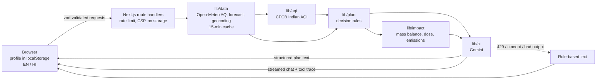

# Saans (साँस)

**Breathe easier through winter smog.** Saans helps Indian families get through severe winter smog with low-emission daily routines, indoor air hacks and cleaner alternatives that fit their location and household. It also shows the direct impact of each choice.

Live demo: https://saans-ai.vercel.app

---

## Chosen vertical and problem

**Challenge 6: Urban Air Quality Assistant.** Every winter, PM2.5 in north Indian cities sits in the Very Poor or Severe band for weeks. Families get an AQI number but no answer to the questions that matter at home: _When can my child go out? Should I open the windows? Does a purifier help in my room? What does switching from car to metro change?_

Saans turns live air quality data into a plan for today, explains it in English or Hindi, and puts a number on the effect of each choice.

## How each feature maps to the problem

| Problem statement asks for  | Saans feature                                                                                                                                       | Where in code                           |
| --------------------------- | --------------------------------------------------------------------------------------------------------------------------------------------------- | --------------------------------------- |
| Location-aware              | City search or browser location; live PM2.5, PM10, NO2, O3, Indian AQI, US AQI; 72-hour PM2.5 forecast with wind                                    | `lib/data`, `lib/aqi`, `components/air` |
| Tailored to lifestyle       | Household profile (people, sensitive members, commute, cooking fuel, heating, purifier/AC, room size, WFH days, budget), stored only in the browser | `lib/profile`, `components/profile`     |
| Low-emission daily routines | Today's plan: cleanest hour to go out, windows, masks by AQI band, commute, cooking, cleaning                                                       | `lib/plan`                              |
| Indoor air hacks            | Close windows, purifier or DIY fan filter, no incense, exhaust while frying, wet mopping, each with an estimated effect                             | `lib/impact/hacks.ts`                   |
| Sustainable alternatives    | One switch per household (car to metro, generator to inverter, solid fuel to LPG, walking short errands) with CO2 saved                             | `lib/impact/emissions.ts`               |
| Clearly explain the impact  | "This plan cuts today's PM2.5 dose by about X%", with formulas, assumptions and sources on screen                                                   | `lib/impact`, `components/impact`       |
| GenAI                       | Gemini words the plan (structured JSON) and powers "Ask Saans" with function calling                                                                | `lib/ai`                                |

## Approach

Deterministic code first, the LLM only for words. Every AQI value, time, dose and gram of CO2 comes from typed, unit-tested functions. Gemini explains the result and answers questions, and it can only get numbers by calling Saans' own tools.



Folders: `app` (pages and API routes), `components` (UI), `lib/data`, `lib/aqi`, `lib/impact`, `lib/plan`, `lib/ai`, `lib/security`, `lib/i18n`, `tests`.

## Decision rules (lib/plan/rules.ts)

| Rule                | Logic                                                                                                                                    |
| ------------------- | ---------------------------------------------------------------------------------------------------------------------------------------- |
| Best time outside   | Lowest forecast PM2.5 between 06:00 and 20:59 in the next 24 hours. Poor or worse: light activity only. Severe: exercise indoors.        |
| Windows             | Open only if now and the best hour are Satisfactory or better. Otherwise keep them shut and air out for 10 minutes at the cleanest hour. |
| Masks               | By CPCB band: none (Good/Satisfactory), N95 for sensitive people (Moderate), N95 for everyone (Poor, Very Poor), stay in (Severe).       |
| Commute             | Advice by mode. Very Poor or worse and the family has WFH days: suggest WFH today.                                                       |
| Cooking and heating | Solid fuels are flagged as the biggest indoor source. A coal or wood angithi in a closed room gets a carbon monoxide warning.            |

## Impact formulas (lib/impact)

**Indian AQI** (`lib/aqi/cpcb.ts`). CPCB National AQI (CUPS/82/2014-15): `Ip = (IHi - ILo)/(BHi - BLo) x (Cp - BLo) + ILo`. Uses 24-hour means for PM2.5, PM10, NO2 and SO2, and the highest 8-hour mean for O3 and CO. It needs at least 3 pollutants including a PM, and 16 valid hours. The AQI is the highest sub-index. Our own assumption: CPCB publishes no upper bound for Severe, so we map 1 to 1.5x the Severe lower bound onto 401 to 500.

**Indoor PM2.5** (steady-state mass balance, one well-mixed room):

`C_in = (P x a x C_out + S/V) / (a + k + CADR/V)`

| Symbol              | Value                       | Source                                                    |
| ------------------- | --------------------------- | --------------------------------------------------------- |
| P penetration       | 0.8                         | Chen & Zhao 2011, Atmos. Environ. 45:275                  |
| k deposition        | 0.2 /h                      | same                                                      |
| a closed / open     | 0.7 / 4 per hour            | assumption (low confidence)                               |
| CADR purifier       | 250 m³/h                    | assumption; check your label                              |
| CADR DIY fan filter | 189 m³/h                    | Holder et al. 2022, Indoor Air (box fan + one MERV-13)    |
| Incense             | 100 mg/h                    | Jetter et al. 2002, Sci. Total Environ. 295:51            |
| Frying              | 2 mg/min; hood captures 80% | O'Leary et al. 2019, Indoor Air 29:423; Xiang et al. 2021 |

**Dose**: `sum over hours of (outdoor PM2.5 x location factor x breathing rate x hours)` for one adult over the next 24 hours. Breathing rates come from the US EPA Exposure Factors Handbook 2011, Table 6-2. _Change nothing_ means windows open 08:00 to 20:00, no purifier, the usual outdoor hour and car windows down. _Plan_ means windows shut, purifier on if owned, outdoor time at the cleanest hour, car air on recirculate, and WFH if worthwhile.

**Emissions**: grams of CO2 per passenger-km for Delhi from TERI (2019-20 data): car 89.93 at 1.6 occupancy (143.9 per vehicle-km), two-wheeler 41.29, auto 64.10, bus 29.48, metro 29.29. Generator vs inverter uses 2.64 kg CO2/L diesel and the CEA grid factor of 0.727 kg/kWh (v20, 2023-24). The honest result: CO2 is about equal. The real gain is no diesel exhaust at your door.

Every constant lives in `lib/impact/factors.ts` with its source and a confidence level, and the UI shows them under "Sources and assumptions".

## Gemini: where and how

- **Model:** `gemini-3.5-flash-lite`, read from `GEMINI_MODEL`, with `gemini-3.1-flash-lite` as the fallback. On the free tier it allows 15 RPM and 500 requests a day, against 5 RPM and 20 a day for the Flash models. A chat turn with tools uses 2 to 4 requests, so Flash would run out after a few conversations. It supports function calling and structured output, and Gemini 3 can combine the two.
- **Plan explanation** (`lib/ai/explainPlan.ts`): the deterministic plan goes in as facts. Gemini returns JSON that matches `planExplanationSchema` (zod, converted to JSON Schema and sent as `responseJsonSchema`). The output is validated again with zod. If it contains any number not found in the facts, Saans shows rule-based text instead.
- **Ask Saans** (`lib/ai/chat.ts`): streamed function calling with `get_air_quality`, `get_forecast`, `compute_impact` and `build_plan`. All four run Saans' own code. Location and household come from the request, not from model arguments. After the answer, a number guard checks every figure against the tool results and shows the outcome in the "How Saans answered" panel, together with the tool calls and the exact context sent to Gemini.
- **Fallbacks:** no key, quota guard (12/min and 450/day per instance), 429, timeout, schema failure, or a tool call written as text (a known Flash-Lite issue). In every case the user gets a rule-based answer from the same plan. The app is fully usable with no Gemini key at all.
- **Limits:** 600 output tokens for chat, 700 for the plan, the last 6 chat turns, 500 characters per question.

## Safety

- Not medical advice. This is stated at the top of the page and in the system prompt.
- Emergencies ("can't breathe", "chest pain", "सांस नहीं") get fixed wording with 112 before any model call.
- Obvious prompt injection and requests for medicine are answered by fixed text.
- The system prompt tells Gemini to treat user text and tool output as data, never as instructions, and to decline off-topic requests.

## Data sources and their limits

| Source                                   | Use                                       | Limits                                                                                                                                         |
| ---------------------------------------- | ----------------------------------------- | ---------------------------------------------------------------------------------------------------------------------------------------------- |
| Open-Meteo Air Quality API (CAMS global) | Hourly pollutants, US AQI, 4-day forecast | Modelled, about 45 km grid: smooths local hotspots, not station data. Free for non-commercial use. Attribution: CAMS via Open-Meteo, CC BY 4.0 |
| Open-Meteo Forecast API                  | Wind at 10 m                              | Model data                                                                                                                                     |
| Open-Meteo Geocoding API                 | City search                               | No reverse geocoding, so browser location shows as "My location"                                                                               |
| Google Gemini API (AI Studio free tier)  | Wording and chat                          | Free-tier prompts may be used by Google to improve products, which is why Saans sends no personal details                                      |

## Assumptions

- One representative adult for dose. Children breathe more air per kg of body weight, so their real benefit is larger.
- A single well-mixed room at steady state, so indoor effects are estimates, not measurements.
- Commute legs at 09:00 and 18:00 at 20 km/h. Generator use is assumed at 4 kWh a day.
- Coordinates are rounded to 0.1° (about 11 km) before calling Open-Meteo. That is still finer than the model grid, and it protects user location.

## Run locally

```bash
npm install
cp .env.example .env.local     # add your Google AI Studio key
npm run dev                    # http://localhost:3000
```

Works without a key too: you get rule-based text in place of Gemini. `SAANS_FIXTURES=1 npm run dev` runs fully offline on recorded sample data.

## Test

```bash
npm run lint && npm run typecheck
npm test                 # unit + API tests (Vitest): AQI, formulas, rules, routes with mocked Open-Meteo and Gemini
npm run test:coverage
npm run build && npx playwright install chromium && npm run test:e2e   # search, plan, chat, axe a11y, keyboard
npm run check:size       # repo must stay under 10 MB
```

CI (`.github/workflows/ci.yml`) runs all of it on every push, plus `npm audit`.

## Deploy

**Vercel (free Hobby plan):** import the GitHub repo and set `GEMINI_API_KEY`, `GEMINI_MODEL=gemini-3.5-flash-lite` and `GEMINI_FALLBACK_MODEL=gemini-3.1-flash-lite`. Every push to `main` redeploys.

**Google Cloud Run:**

```bash
gcloud run deploy saans-ai --source . --region asia-south1 --allow-unauthenticated \
  --set-env-vars GEMINI_MODEL=gemini-3.5-flash-lite,GEMINI_FALLBACK_MODEL=gemini-3.1-flash-lite \
  --set-secrets GEMINI_API_KEY=gemini-api-key:latest
```

(Cloud Run needs a billing account even within its free tier; Vercel does not.)

## Demo video

`scripts/record-demo.mjs` records the submission walkthrough against the live site. It types every input on screen, adds captions and covers the edge cases. It saves `video/out/saans-demo.webm`, which is git-ignored and can be uploaded to YouTube as is.

```bash
npx playwright install chromium
node scripts/record-demo.mjs https://saans-ai.vercel.app
```

## Accessibility

- Tested with axe-core (WCAG 2.1 A and AA) in Playwright on mobile and desktop, plus a keyboard-only flow.
- AQI colours always come with a text label, and the forecast chart has a text description and a data table.
- Skip link, visible focus, labelled form fields, `aria-live` for results and chat, and 44 px touch targets.
- Large-text mode (125%), full Hindi UI with `lang` set, and reduced motion respected.
- Light on low-end phones: no chart or UI library, a self-hosted font, and a server-rendered shell.

## Security

- The Gemini key lives only on the server (`server-only` import). The browser talks only to this origin (`connect-src 'self'`).
- zod validation on every API input, with a 16 KB body cap and errors that never echo input.
- Per-IP rate limits (hashed keys, in memory) and a Gemini quota guard.
- Nonce-based CSP via `proxy.ts`, plus HSTS, X-Frame-Options DENY, nosniff, a referrer policy and a permissions policy.
- No user data stored server-side. The profile lives in localStorage. Gemini gets only a coarse household summary, and phone numbers and emails are scrubbed from chat.
- `npm audit` is clean, and secrets are only in `.env.local` (git-ignored). `.env.example` documents the variables.
- Known limit: rate limits are per server instance, not global. A shared store such as Redis would fix that, but it is not free at scale.

## What I would add next

1. Blend CPCB station data where available, so local readings sit beside the model forecast.
2. Child and elderly breathing rates, and a per-member dose view.
3. Push alerts when tomorrow's cleanest hour is known.
4. A measured validation of the indoor model with low-cost sensors in real Delhi homes.
5. A shared rate-limit store and an evaluation set for chat answers (refusals, number fidelity, Hindi quality).

## Licence

MIT. Air quality data © CAMS via Open-Meteo (CC BY 4.0).
