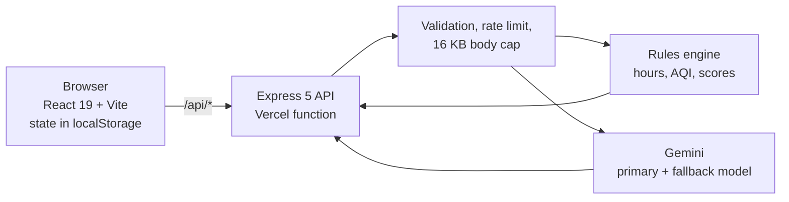

# Saans (साँस)

**Breathe easier through winter smog.** Saans helps families in smog-hit Indian cities decide what to do today: when to go out, when to keep windows shut, how to commute with less exposure, and how to clean the air at home. Gemini explains every recommendation in plain language, in English, Hindi, Arabic or Spanish.

Live app: https://saans-ai-kappa.vercel.app

Built for **Challenge 6: Urban Air Quality Assistant**.

---

## 1. At a glance

| Challenge asks for          | Where it is in Saans                                                                                     |
| --------------------------- | -------------------------------------------------------------------------------------------------------- |
| Location-aware              | **Air Telemetry** tab: AQI, PM2.5, PM10, NO2, CO, O3, inversion risk and a heatmap for five city sectors |
| Tailored to lifestyle       | Six household profiles (asthmatic child, newborn, elderly, commuter, school run, community lead)         |
| Low-emission daily routines | **Routine Optimizer**: hour-by-hour plan with the best outdoor window                                    |
| Indoor air hacks            | **Indoor Air & Hacks**: purifier (CADR) calculator, window schedule, DIY filter box                      |
| Sustainable alternatives    | **Low-Emission Transit**: lowest-exposure route plus dose and CO2 for each travel mode                   |
| Explain the impact          | Inhaled PM2.5 dose, CO2 saved, community PM2.5 and CO2 averted                                           |
| GenAI                       | **Ask Saans**, routine wording and multilingual emergency advisories, all by Gemini                      |

## 2. How GenAI is used

| Feature                                   | What Gemini does                                                                      | What stays in code                                 |
| ----------------------------------------- | ------------------------------------------------------------------------------------- | -------------------------------------------------- |
| **Ask Saans** (Air Telemetry tab)         | Answers a typed question using the selected sector's readings and household profile   | Input limits, emergency check, prompt fencing      |
| **Routine Optimizer**                     | Writes the rationale, activity and health note for each hour, and four household tips | Every hour, AQI forecast, score and outdoor window |
| **Emergency advisory** (Community Action) | Writes a 2 to 3 sentence public advisory in the chosen language                       | Readings it may quote                              |

Three rules hold everywhere:

- **Numbers come from code, words come from Gemini.** Gemini cannot change an hour, an AQI value or a score. If its JSON is unusable, the rules text is used.
- **You can see the source.** Every answer carries a badge: _Live Gemini answer · model name_, _Offline rules_, or _Safety check_. Ask Saans also shows the exact prompt it sent.
- **It never goes silent.** If Gemini is slow or unavailable, Saans tries a fallback model, then answers from rules.

## 3. Architecture



- **Frontend:** React 19, TypeScript (strict), Tailwind CSS 4, Vite 6. All charts and the heatmap are plain SVG.
- **Backend:** one Express app (`server.ts`). Vercel runs it as a single function through `api/index.ts`; locally it runs with `npm run server`.
- **AI:** `@google/generative-ai`, model set by `GEMINI_MODEL` with optional `GEMINI_FALLBACK_MODEL`.

## 4. Run it locally

Requires Node.js 22.

```bash
npm ci
cp .env.example .env        # add your GEMINI_API_KEY
npm run server:dev          # API on http://localhost:3001
npm run dev                 # app on http://localhost:5173 (proxies /api)
```

Without a key, Saans still works and labels its answers as _Offline rules_.

Production build served by Express: `npm run build && npm run server`, then open http://localhost:3001.

## 5. Quality checks

| Command                | What it checks                                      |
| ---------------------- | --------------------------------------------------- |
| `npm run lint`         | Oxlint with warnings treated as errors              |
| `npm run format:check` | Prettier                                            |
| `npm run typecheck`    | TypeScript strict mode                              |
| `npm run test:run`     | 96 Vitest tests: logic, UI, API and Gemini handling |
| `npm run build`        | Production bundle                                   |

GitHub Actions runs all five on every push and pull request (`.github/workflows/ci.yml`).

## 6. Deploy

`vercel.json` builds the Vite app, sends `/api/*` to the Express function and sets security headers. Set these environment variables in Vercel:

| Variable                | Required | Example                  |
| ----------------------- | -------- | ------------------------ |
| `GEMINI_API_KEY`        | Yes      | from Google AI Studio    |
| `GEMINI_MODEL`          | No       | `gemini-3.1-flash-lite`  |
| `GEMINI_FALLBACK_MODEL` | No       | another Flash-Lite model |

## 7. Project layout

```text
api/index.ts        Vercel entry, reuses the Express app
server.ts           Express app: routes, headers, cache, SPA fallback
server/             Gemini client, routine and advisory text, Ask Saans, validators, middleware
src/components/     One folder per tab, plus Ask and shared pieces
src/lib/            Pure calculations: AQI breakpoints, CADR, dose, Dijkstra routing
src/test/           Vitest suites
```

## 8. Known limits

- Sector readings are **sample telemetry** for five representative city sectors, with buttons to simulate a smog spike or clean-up. They are not a live sensor feed.
- The rate limit and response cache live in memory, so each serverless instance keeps its own.
- Saans gives general guidance, not medical advice. Emergency wording always points to 112.

## 9. More detail

[What changed in this version](CHANGELOG.md) · [Security](SECURITY.md) · [Problem alignment](PROBLEM_ALIGNMENT.md) · [Testing](TESTING.md) · [Accessibility](ACCESSIBILITY.md) · [Efficiency](EFFICIENCY.md) · [Code quality](CODE_QUALITY.md) · [Decisions](docs/DECISIONS.md)

## License

[MIT](LICENSE)
